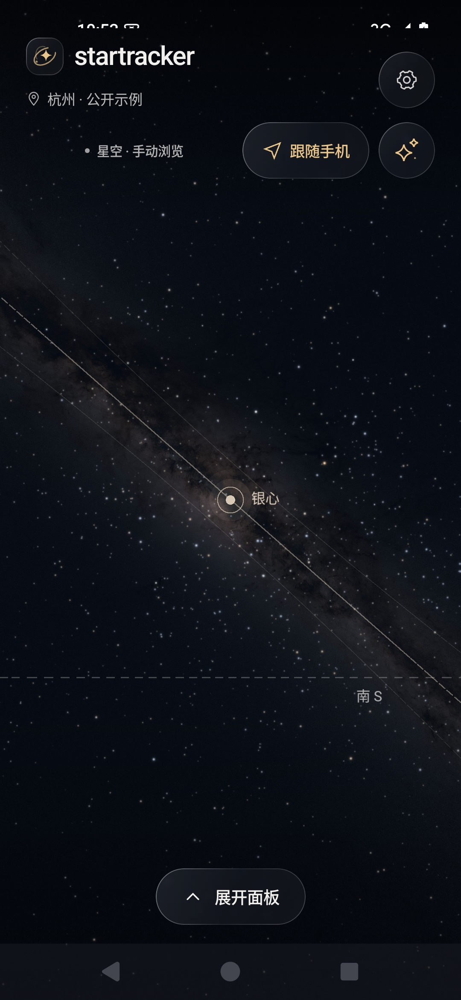
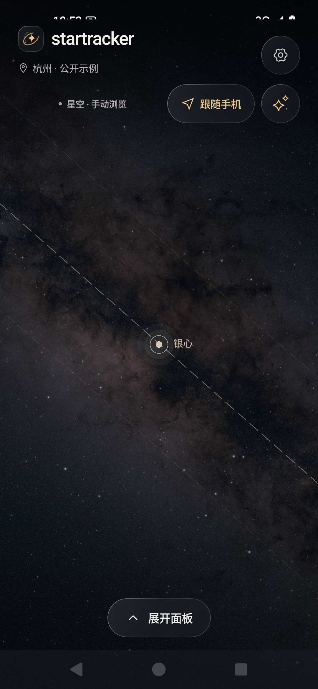
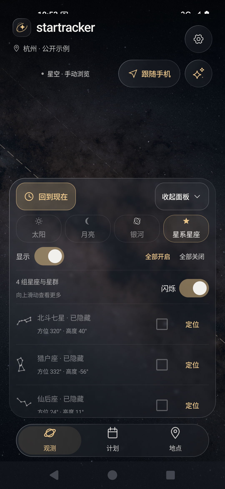
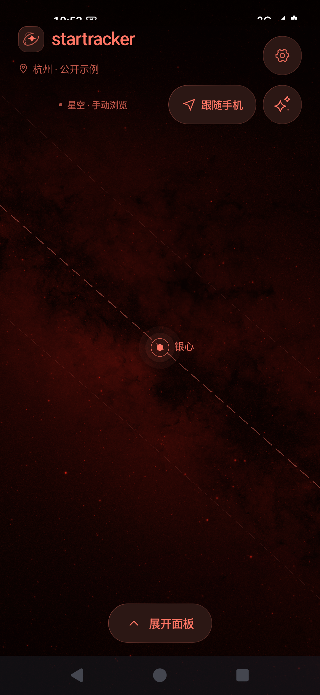

# startracker

**离线星空与实景 AR 观测工具，采用简洁的毛玻璃界面。**
**An offline sky map and camera AR app with a minimal frosted-glass interface.**

`0.10.1-preview` · 中文应用界面 / Chinese app UI · 无账号、会员或广告 / No account, subscription or ads

## 功能 · Features

| 中文 | English |
| --- | --- |
| 太阳、月亮的位置、升落时间与方向，按地点和日期预览 | Sun/Moon positions, rise/set times and directions by location and date |
| 银河位置、16K 分块背景与 99,049 颗真实恒星 | Milky Way positioning, tiled 16K imagery and 99,049 catalog stars |
| 实景 AR 与星空切换、跟随手机、星图双指缩放 | Camera AR / sky-map toggle, motion tracking and sky-map pinch zoom |
| 北斗七星、猎户座、仙后座、南十字座的标记与连线 | Markers and lines for the Big Dipper, Orion, Cassiopeia and Southern Cross |
| 底部分类开关、可收起面板、独立十字星芒闪烁、夜间红光 | Bottom layer controls, collapsible panel, optional star twinkle and red night mode |
| 手机定位、离线城市、手动坐标与时间预览；核心功能离线运行 | Device location, offline cities, manual coordinates and time preview; offline core |

## 适用手机 · Devices

- **已测试 / Tested:** REDMI K80 · HyperOS 3.0.308 · Android 16。
- **最低要求 / Minimum:** Android 11+；目前优先小米/红米，其他型号尚未真机验证。Xiaomi/Redmi are the current focus; other models are unverified.
- **AR:** 需要相机与方向传感器；无需 GMS 或 ARCore。Requires a camera and orientation sensors; no GMS or ARCore dependency.
- **iPhone:** 尚未支持，后续计划。Not supported yet; planned for later.

预览版本：AR 对准受传感器、磁干扰及镜头误差影响；尚未完成户外角精度验收。
Preview build: AR alignment depends on sensors, magnetic conditions and camera calibration; outdoor angular accuracy has not been validated.

## 界面 · Screenshots

实际应用截图，使用公开杭州示例地点；无手机私人照片。
Actual app captures using a public Hangzhou example location, with no personal camera photos.

<table>
<tr><td align="center">星空 · Sky map</td><td align="center">银河细节 · Milky Way detail</td></tr>
<tr><td></td><td></td></tr>
<tr><td align="center">底部控制 · Observation controls</td><td align="center">夜间模式 · Night mode</td></tr>
<tr><td></td><td></td></tr>
</table>

## 构建 · Build

先安装 JDK 21、Python 3 和 Android SDK；设置 `JAVA_HOME` / `ANDROID_HOME`。
Install JDK 21, Python 3 and the Android SDK; set `JAVA_HOME` / `ANDROID_HOME`.

```sh
git clone https://github.com/kimbluerain/startracker.git
cd startracker
python3 scripts/build-android.py :app:assembleDebug
```

APK：`android/app/build/outputs/apk/debug/app-debug.apk`。首次构建需要联网，运行时无需计算服务器。
The first build needs internet access; the app needs no calculation server. [构建细节 / Build details](docs/BUILD.md)

## 来源 · Credits

基于 / Based on [Heliodos](https://github.com/domob1812/heliodos) · [GPLv3](LICENSE)。Astronomy Engine、GeoNames、HYG、NASA/ESA 数据分别保留其许可和署名 / Third-party code and data retain their respective licenses and credits. [NOTICE](NOTICE) · [Dependencies](DEPENDENCIES.md)
